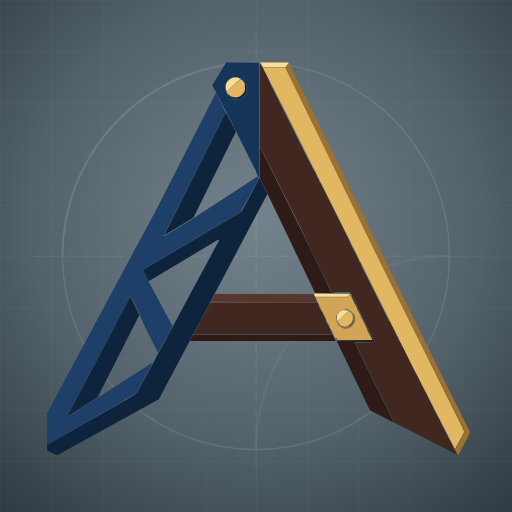

<p align="center">
  
</p>

# Axiomata

Axiomata provides the foundation for complex objects that players build and interact with directly
in the world, beyond the usual item, block and single-hitbox entity systems. It currently includes:

- A data-driven blueprint system with drawing quality and staged, in-world construction
- Model-based geometry used for collision, interaction, moving surfaces, climbing and pathfinding
- Projectile flight and aiming, penetration, block damage, debris and artillery particles
- Timed loading stages for players and automated crews

## For mod developers

Blueprint integrations use `UnderConstruction`. Model collision integrations use
`CollidableStructure`. Their supporting APIs are under `me.mss1r.axiomata.blueprint.api` and
`me.mss1r.axiomata.collision`.

Call `StructureMotionSystem.tickStructure(this)` after updating a structure's position and posed
groups. It carries supported players and other `CollidableStructure` entities, including stacked
loads. Only `solidCollisionGroups()` can support another structure. A load can additionally declare
`supportContactGroups()`, e.g. contact-only wheel feet or a climb-through ladder. These extra parts
are used for placement and finding support, not as invisible obstacles. Cargo remains server-owned
and is not a passenger. Unfinished builds use their planned footing even before the first section
exists, while only their built sections physically collide. Contacts are rediscovered after loading;
no entity IDs or mounted attachments are saved. Registration and removal follow the entity's level
lifecycle, including motionless sites loaded from disk.
Consumers with a separate root-yaw field override `rotateWithSupport` to update that field too.

`Entity.move` uses the solid geometry for translation. Code that moves with `setPos` instead must
first constrain its displacement with `StructureTerrainCollision.clampMotion`. That method also
checks clearance for supported loads. `clampYaw` checks the turning arc; `canOccupy` checks
a single proposed root pose.
`clampMotionAt` sweeps translation from a proposed pose without moving the entity,
for server-side route planning with the same geometry and supported loads.

`BlueprintEvents.WORK` quotes the work of each construction hammer blow on the
server. Listeners can multiply work without changing the stage's materials.
Fractional progress is saved; work stops at the stage boundary, so surplus
cannot build the next stage without paying for it.
`ConstructionTarget.pick(player, reach, partialTick, fluids)` selects the nearest block or finished
solid structure surface. It ignores decorative rigging and respects block occlusion; fluid targets
remain block-only. Recompute the aim on the server. `StructurePlacement.findOnTop` returns a candidate
pose and supporting group without spawning anything; pass the hit's Y coordinate to place on a deck
below a mast rather than above the whole structure. Validate the proposed pose with
`StructurePlacement.isClear` before applying it: it checks blocks, the world border, other structures
and the space reserved by unfinished sites. Consume the item only after successful entity addition.
`ConstructionDeployer.deploy` accepts a `ConstructionTarget`; its block-based overload is retained.

Artillery integrations extend `BallisticProjectile` and provide their own projectile catalog and
`ImpactResolver`. Block-damage policy and player attribution stay with the consuming mod.
`ImpactResolver.contactImpact` handles blunt strikes using energy in joules and an oriented
contact box. Its local Z axis points into the wall; lateral spread damages connected exposed
blocks without creating a projectile channel or blast crater.
Loading uses `LoadingController.Host` and `LoadingRequirement`; each weapon supplies its stages,
timings, sounds and completion callbacks. These APIs are under `me.mss1r.axiomata.ballistics`,
`me.mss1r.axiomata.data.profile` and `me.mss1r.axiomata.loading`.

Call `DebrisPhysics.register()` during mod startup so saved debris can find your block-damage policy.
Entities with projectile openings implement `ProjectilePassThroughControl`; Axiomata installs
the impact handler. Custom `ParticleSet`s need smoke sprite definitions and client providers;
the flash core is registered and supplied by Axiomata.

Add fixed-count components to the item tag `axiomata:quality_cost_exempt` to keep their blueprint
cost independent of drawing quality. A material specified by a tag is exempt only when all its
items are exempt. Material tags use `tag.item.<namespace>.<path>` translations (`/` becomes `.`);
without a translation, the build menu shows the tag ID.

### Gradle

```gradle
repositories {
    maven { url 'https://jitpack.io' }
    maven { url 'https://maven.architectury.dev/' }
}

dependencies {
    implementation "com.github.mess1re.axiomata:${minecraftVersion}-${loader}:${axiomataVersion}"
}
```

`minecraftVersion` and `loader` select the matching build; `axiomataVersion` is the release tag.
ForgeGradle projects should pass the coordinate through `fg.deobf(...)`.

## Building

Run `./gradlew build` (`gradlew.bat build` on Windows). Version-specific jars are written to
`versions/<target>/build/libs`.

## Blockbench tool

The construction-section plugin and its installation instructions are in
[`tools/blockbench`](tools/blockbench).

## Contributing

See [`CONTRIBUTING.md`](CONTRIBUTING.md).

## License

Source code, build scripts and non-artistic data are licensed under
[LGPL-3.0-only](LICENSE). Original artistic assets are covered by
[`LICENSE-ASSETS.md`](LICENSE-ASSETS.md).
